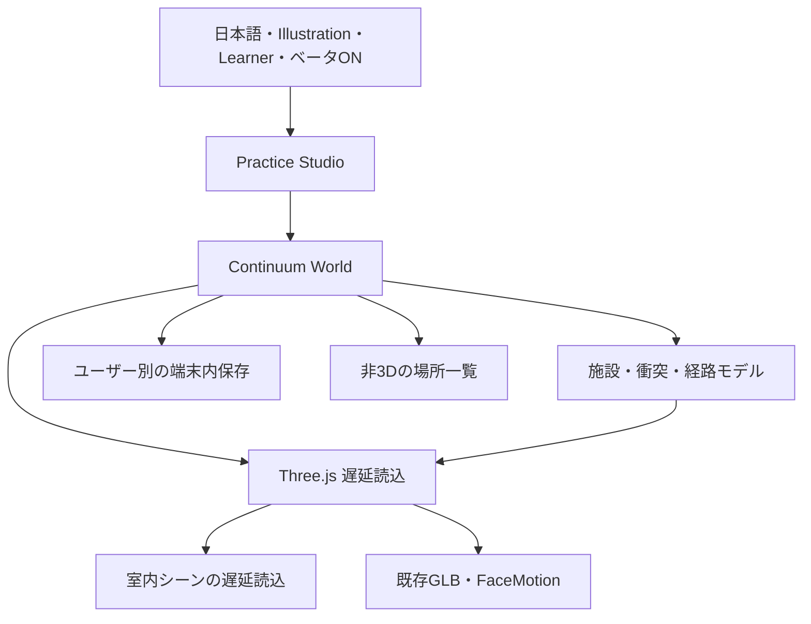

# Continuum World Tokyo — Phase 1

作業日は2026年11月26日。対象は Phase 1 の探索試作。ブランチは `codex/continuum-world-tokyo-phase1`。

## 監査と設計

開始時の `main` は `797918de26da578a014387dbec91920366ea4ef6`。変更前に `rpg-world-model.test.mjs`、`companion-call-rig.test.mjs`、`interface-templates.test.mjs` を実行し、16件成功・失敗0件だった。

| 対象 | 調査結果と採用方法 |
| --- | --- |
| Practice Studio | `PracticeStudio.jsx` の既存ビュー選択から、ベータ用カードで遅延読込する。 |
| 既存RPG | `RPGWorld.jsx` と `rpg-world-model.mjs` は道路グラフ型の別体験。新しい歩行空間とは座標系を分ける。 |
| 3D | 既存の `three` を直接使用。レンダラ追加パッケージは不要。 |
| コンパニオン | `companion-call-models.mjs` の8種類の既存GLB、`bindFaceRig`、`FaceMotion` を再利用。選択済みの種類は認証済み `/api/adventure?language=ja` から取得。 |
| 表示言語 | `interface-copy.mjs` の翻訳機構へ、英語と既存9表示言語のオフライン文言を追加。NPC台詞は日本語の学習コンテンツ。 |
| ネイティブ | `isAppHidden` と `continuum-native-visibility` に接続し、中断時に入力・描画・環境音を停止。 |
| Learning Memory | `LanguageOverview.jsx`、`IllustratedMemory.jsx`、`saved-timeline.mjs` は練習証拠と授業メモを扱う。新しい学習証拠は Phase 2 で既存の言語別集約に合わせて追加する。 |
| 会話・音声 | `speaking-api.mjs` と既存会話の音声・制限処理を Phase 2 で再利用する。`/api/speech` は登録教材用の制約があるため、自由なNPC発話を無条件に渡す設計にはしない。 |
| 認証・権限 | `required(req,'learner')`、`share_self_learning`、授業の担当関係・言語の制約を Phase 2 のサーバー側連携にも適用する。 |
| DB | Phase 1 は探索位置と設定のみを端末内に保存する。新テーブル・移行・コース実績への書込みは不要。 |



## 実装範囲

- 架空の東京街区、三人称の徒歩・走行、WASD／方向キー、Shift、仮想スティック、ドラッグ視点。
- 建物と街区境界の衝突、壁手前で短くなるカメラ、目的地マーカー、ミニマップ、安全位置への復帰。
- カフェとコンビニの室内への入退場、駅の案内係と公園の住民。各地点に名前・性格・口調・役割・語学目標を定義。
- コンパニオンの追従と障害物を回避する経路。既存GLBと顔の動作を使用。
- Auto／Low／Medium／High、簡易昼夜、モーション軽減、初期OFFの生成環境音と音量。
- ユーザー別キー `continuumWorld:tokyo:v1:<user-id>` への位置・場所・視点・設定の保存。保存不能時の通知。
- 非表示・ネイティブ中断・ウィンドウのフォーカス喪失・ダイアログ表示時の停止。リサイズ対応、WebGL喪失時の再読込と場所一覧。
- キーボード操作、モーダルのフォーカス制御、画面読み上げ向けの場所一覧による移動と台詞表示。

街・人物・内装はプロシージャルな試作用アート。最終的なアート制作と実機での画質調整は次の検証対象。

## プライバシーと運用

Phase 1 のNPC台詞は公開の固定文で、ユーザーの会話入力は受け付けない。NPC個人記憶、マイク、録音、AI会話呼出し、ミッション報酬、Learning Memory書込みは Phase 2 の未実装項目。現在はNPC記憶を保存する経路がなく、同意・閲覧・削除の画面は Phase 2 で実装・検証する。

探索の保存にはユーザーごとの端末内キーを用いる。端末をまたぐ復帰は Phase 2 の認証済みサーバー保存で扱う。位置や設定をコースの達成・XPへ変換する処理はない。

3Dは開いた画面内でのみ作成する。室内のコードは入場時に読込する。会話生成の常時実行や新しい有料API呼出しは発生しない。

## アセットと出典

| 資産 | 出典 |
| --- | --- |
| 建築・人物・植物・什器・看板 | 本変更の独自Three.jsジオメトリとCanvas文字描画。 |
| コンパニオン | リポジトリ既存の `public/companions-3d/*-pop-*.glb` と既存の制作スクリプト。 |
| カード画像 | 既存の日本語Illustration画像を利用。 |
| 環境音 | `continuum-world-audio.mjs` が生成するフィルタ済みノイズ。外部録音の利用はない。 |

既存ゲームのロゴ・モデル・音楽・地図アセットは含めていない。

## 検証コマンドと証跡

```sh
node --test continuum-world-model.test.mjs interface-templates.test.mjs
node scripts/qa-continuum-world.mjs
npm run test:qa
npm run test:illustrated:browser
npm run test:rpg:browser
npm run test:rpg:touch
npm run ios:sync
npm run test:native
```

`scripts/qa-continuum-world.mjs` は本番サービスへの書込みを行わず、実コンポーネントをビルドした隔離ハーネスで検証する。新しいブラウザーQAワークフローは PR 専用で、画像と計測値を `continuum-world-phase1-evidence` に保存する。

検証結果と性能値は、実行終了後にこの報告へ追記する。iPhone実機のFPS・メモリ・発熱は未計測で、デスクトップのソフトウェア描画の値から推定しない。

## フラグとロールバック

既定は `VITE_CONTINUUM_WORLD_TOKYO_BETA=false`。隔離したプレビュー用ビルドでのみ `true` を指定する。

```sh
VITE_CONTINUUM_WORLD_TOKYO_BETA=true npm run build
VITE_CONTINUUM_WORLD_TOKYO_BETA=true npm run ios:sync
```

OFFへ戻す場合は `VITE_CONTINUUM_WORLD_TOKYO_BETA=false` で再ビルドする。既存の `features` に `continuumWorldTokyoBeta:false` が渡された場合も入口と開いているワールドを閉じる。管理画面に新しい設定項目は追加していない。

ベータをOFFにしても端末の探索位置は保持される。データベースのロールバック操作は不要。本番へのマージ・デプロイは未承認。

## 次フェーズへの条件

Phase 1 の操作・衝突・入退場・保存復帰・中断復帰・非3D操作と既存機能の回帰を確認してから、Phase 2 のカフェNPC一人分のE2Eを接続する。自由会話、音声、根拠付き学習記録、NPC記憶の明示的オプトインと削除を先に検証する。地区拡張、交通・歩行NPC、ミッションや物語分岐の本格導入はその後に進める。
