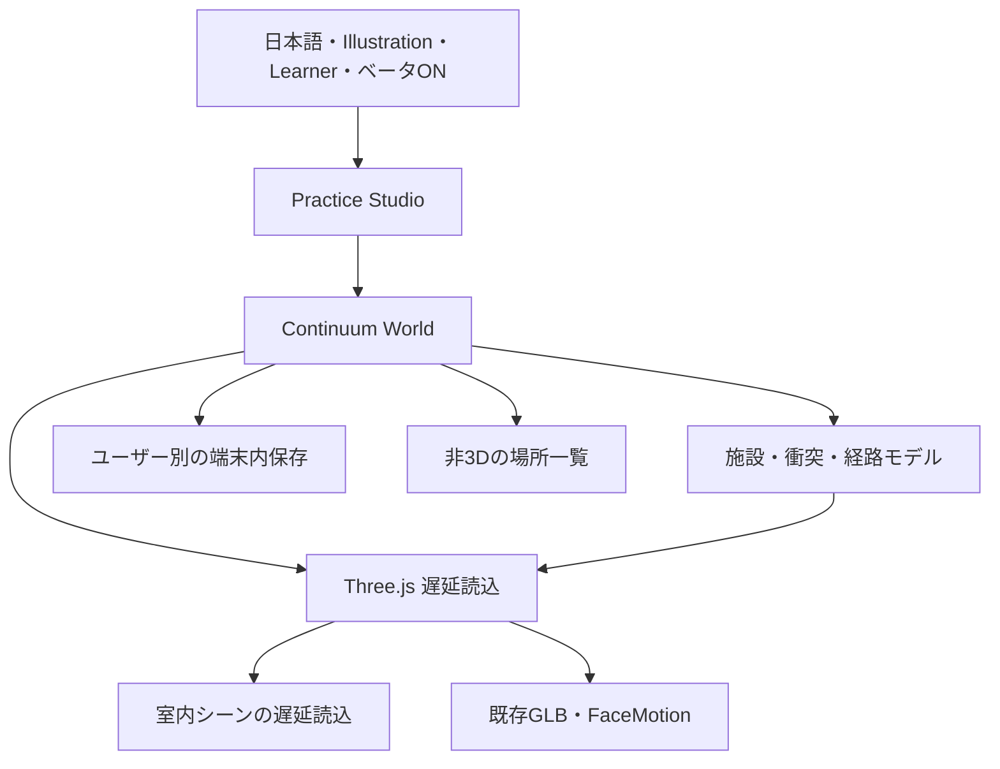

# Continuum World Tokyo — Phase 1

作業日は2026年11月26日。対象は Phase 1 の探索試作。ブランチは `codex/continuum-world-tokyo-phase1`。

## 監査と設計

開始時の `main` は `797918de26da578a014387dbec91920366ea4ef6`。変更前に `rpg-world-model.test.mjs`、`companion-call-rig.test.mjs`、`interface-templates.test.mjs` を実行し、16件成功・失敗0件だった。

| 対象 | 調査結果と採用方法 |
| --- | --- |
| Practice Studio | `PracticeStudio.jsx` の既存ビュー選択から、ベータ用カードで遅延読込する。 |
| 既存RPG | `RPGWorld.jsx` と `rpg-world-model.mjs` は道路グラフ型の別体験。新しい歩行空間とは座標系を分ける。 |
| 3D | 既存の `three` を直接使用。レンダラ追加パッケージは不要。 |
| コンパニオン | `companion-call-models.mjs` の8種類の既存GLB、`bindFaceRig`、`FaceMotion` を再利用。選択済みの種類は認証済み `/api/adventure?language=ja` から取得。 |
| 表示言語 | `interface-copy.mjs` の翻訳機構へ、英語と既存9表示言語のオフライン文言を追加。NPC台詞は日本語の学習コンテンツ。 |
| ネイティブ | `isAppHidden` と `continuum-native-visibility` に接続し、中断時に入力・描画・環境音を停止。 |
| Learning Memory | `LanguageOverview.jsx`、`IllustratedMemory.jsx`、`saved-timeline.mjs` は練習証拠と授業メモを扱う。新しい学習証拠は Phase 2 で既存の言語別集約に合わせて追加する。 |
| 会話・音声 | `speaking-api.mjs` と既存会話の音声・制限処理を Phase 2 で再利用する。`/api/speech` は登録教材用の制約があるため、自由なNPC発話を無条件に渡す設計にはしない。 |
| 認証・権限 | `required(req,'learner')`、`share_self_learning`、授業の担当関係・言語の制約を Phase 2 のサーバー側連携にも適用する。 |
| DB | Phase 1 は探索位置と設定のみを端末内に保存する。新テーブル・移行・コース実績への書込みは不要。 |

既存RPGのブラウザーQAには開始時点の不整合がある。`main.jsx` は現在 `IllustratedOverview` を表示し、`RPGWorld.jsx` をマウントしていない。変更前の `797918d` を別の作業コピーでビルドして `test:rpg:browser` を実行した場合も、`.rpg-world-open` を待つ同じ行でタイムアウトした。本変更の対象には旧RPGの入口の再設計を含めていない。旧RPGのモデル・単体描画は全体テストにも含まれる。



## 実装範囲

- 架空の東京街区、三人称の徒歩・走行、WASD／方向キー、Shift、仮想スティック、ドラッグ視点。
- 建物と街区境界の衝突、壁手前で短くなるカメラ、目的地マーカー、ミニマップ、安全位置への復帰。
- カフェとコンビニの室内への入退場、駅の案内係と公園の住民。各地点に名前・性格・口調・役割・語学目標を定義。
- コンパニオンの追従と障害物を回避する経路。既存GLBと顔の動作を使用。
- Low画質と狭い画面のAutoでは、同じGLBから一度描画したポートレートを使う軽量な追従表示へ切り替える。Medium／Highでは3Dモデルを表示する。
- Auto／Low／Medium／High、簡易昼夜、モーション軽減、初期OFFの生成環境音と音量。
- ユーザー別キー `continuumWorld:tokyo:v1:<user-id>` への位置・場所・視点・設定の保存。保存不能時の通知。
- 非表示・ネイティブ中断・ウィンドウのフォーカス喪失・ダイアログ表示時の停止。リサイズ対応、WebGL喪失時の再読込と場所一覧。
- キーボード操作、モーダルのフォーカス制御、画面読み上げ向けの場所一覧による移動と台詞表示。

街・人物・内装はプロシージャルな試作用アート。最終的なアート制作と実機での画質調整は次の検証対象。

## プライバシーと運用

Phase 1 のNPC台詞は公開の固定文で、ユーザーの会話入力は受け付けない。NPC個人記憶、マイク、録音、AI会話呼出し、ミッション報酬、Learning Memory書込みは Phase 2 の未実装項目。現在はNPC記憶を保存する経路がなく、同意・閲覧・削除の画面は Phase 2 で実装・検証する。

探索の保存にはユーザーごとの端末内キーを用いる。端末をまたぐ復帰は Phase 2 の認証済みサーバー保存で扱う。位置や設定をコースの達成・XPへ変換する処理はない。

3Dは開いた画面内でのみ作成する。室内のコードは入場時に読込する。会話生成の常時実行や新しい有料API呼出しは発生しない。

## アセットと出典

| 資産 | 出典 |
| --- | --- |
| 建築・人物・植物・什器・看板 | 本変更の独自Three.jsジオメトリとCanvas文字描画。 |
| コンパニオン | リポジトリ既存の `public/companions-3d/*-pop-*.glb` と既存の制作スクリプト。 |
| カード画像 | 既存の日本語Illustration画像を利用。 |
| 環境音 | `continuum-world-audio.mjs` が生成するフィルタ済みノイズ。外部録音の利用はない。 |

既存ゲームのロゴ・モデル・音楽・地図アセットは含めていない。

## 検証コマンドと証跡

| 変更ファイル | 役割 |
| --- | --- |
| `PracticeStudio.jsx`、`.env.example` | ベータの入口と既定OFFのフラグ |
| `ContinuumWorld.jsx`、`continuum-world.css` | 操作UI、設定、場所一覧、保存・ライフサイクル |
| `continuum-world-model.mjs` | 施設・NPC定義、座標検証、衝突、経路探索 |
| `continuum-world-engine.mjs` | 描画、カメラ、入力、追従、WebGL復旧、画質LOD |
| `continuum-world-scenes.mjs`、`continuum-world-interiors.mjs` | 独自の屋外街区と室内 |
| `continuum-world-audio.mjs` | 初期OFFの生成環境音と停止・破棄 |
| `continuum-world-copy.mjs`、`interface-copy.mjs` | 表示言語の文言 |
| `continuum-world-model.test.mjs`、`scripts/qa-continuum-world.mjs` | 単体・ブラウザー検証 |
| `.github/workflows/continuum-world.yml`、本報告 | PR専用QAと監査記録 |

```sh
node --test continuum-world-model.test.mjs interface-templates.test.mjs
node scripts/qa-continuum-world.mjs
npm run test:qa
npm run test:illustrated:browser
npm run test:rpg:browser
npm run test:rpg:touch
npm run ios:sync
npm run test:native
```

`scripts/qa-continuum-world.mjs` は本番サービスへの書込みを行わず、実コンポーネントをビルドした隔離ハーネスで検証する。新しいブラウザーQAワークフローは PR 専用で、画像と計測値を `continuum-world-phase1-evidence` に保存する。

確定したローカル結果は、変更前の基準テスト16件、新モデルと表示文言のテスト10件、ネイティブ関連18件が成功。新しいWorldの1280px／390pxのブラウザー操作も通過し、カフェ・コンビニ・場所一覧・設定保存・画面回転・中断復帰・WebGL喪失後の再読込を確認した。最終コミットの全体回帰とChromium／WebKitの確定結果は [PR #129](https://github.com/messi10ken2-commits/continuum-language/pull/129) のチェック欄と証跡を参照する。旧RPGのブラウザーQAは上記の基準時点の問題を別扱いで報告する。

| コマンド／項目 | 記録 |
| --- | --- |
| 変更前の単体テスト | 16成功、0失敗 |
| 新モデル・表示文言の単体テスト | 10成功、0失敗 |
| `ios:sync` と `test:native` | ベータOFFとONのビルドが成功。18成功、0失敗 |
| Chromium 1280px／390px | 3D操作、実タッチ、施設往復、中断復帰、保存、WebGL再読込が成功 |
| WebKitと全体回帰の最終結果 | PRのチェック欄とCI証跡を参照 |
| `test:rpg:browser` | 変更前・変更後とも同じ `.rpg-world-open` の待機で失敗 |
| `test:illustrated:browser` | 同じ旧RPGスクリプトを呼ぶため、同じ入口の待機で失敗 |
| `test:rpg:touch` | 同じ旧RPGの入口の待機で失敗 |
| Xcode・iPhone実機・VoiceOver | 未実行 |

### ローカルの性能観測

Linux、Headless Chromium 158、SwiftShaderのソフトウェア描画で計測。入力テスト用のビルド済みハーネスを使用し、他のテストも同時実行している。FPSは約1秒の描画回数、CPU描画時間は `renderer.render` の呼出し時間、JSヒープはページ全体の概数。GPU処理時間、ピークメモリ、iPhoneの値を表すものではない。

| カフェ・Low画質 | 初回表示とコンパニオン読込 | 観測FPS | CPU描画呼出し | 三角形 | JSヒープ |
| --- | --- | --- | --- | --- | --- |
| 1280px | 約2.83秒 | 約15 | 約0.6ms | 2,308 | 約72MB |
| 390px | 約1.60秒 | 約31 | 約1.0ms | 2,044 | 約72MB |

軽量化前の390pxでは約149,000三角形・約12fpsを観測した。Low画質の三角形は約98.6%減少した。これらは統制された端末比較ではなく、試作中の観測値として扱う。

iPhone実機の継続30fps、初回ロード、メモリ増大、発熱・バッテリー、VoiceOver、実機の自動ロック復帰は未検証。MacのXcodeコンパイルも未実施。実機を明示して次の評価で計測する。

### 短い操作記録

1. 日本語・Illustration・ベータONでのみPracticeカードを確認。OFF、Photo、他学習言語、TeacherではWorld用レンダラとGLBを読み込まない。
2. プレイヤーをWASDでカフェまで移動し、正面の壁で停止することを確認して入場。
3. 日本語のNPC台詞を開くと描画が停止し、閉じると探索を再開。
4. カフェから屋外へ退出。場所一覧ではカフェ／コンビニへの移動と台詞表示も操作可能。
5. 画質・時間帯・位置を保存して再入場。中断・復帰とWebGLの喪失・再読込も確認。

## フラグとロールバック

既定は `VITE_CONTINUUM_WORLD_TOKYO_BETA=false`。隔離したプレビュー用ビルドでのみ `true` を指定する。

```sh
VITE_CONTINUUM_WORLD_TOKYO_BETA=true npm run build
VITE_CONTINUUM_WORLD_TOKYO_BETA=true npm run ios:sync
```

OFFへ戻す場合は `VITE_CONTINUUM_WORLD_TOKYO_BETA=false` で再ビルドする。既存の `features` に `continuumWorldTokyoBeta:false` が渡された場合も入口と開いているワールドを閉じる。管理画面に新しい設定項目は追加していない。

ベータをOFFにしても端末の探索位置は保持される。データベースのロールバック操作は不要。本番へのマージ・デプロイは未承認。

## 次フェーズへの条件

Phase 1 の操作・衝突・入退場・保存復帰・中断復帰・非3D操作と既存機能の回帰を確認してから、Phase 2 のカフェNPC一人分のE2Eを接続する。自由会話、音声、根拠付き学習記録、NPC記憶の明示的オプトインと削除を先に検証する。地区拡張、交通・歩行NPC、ミッションや物語分岐の本格導入はその後に進める。

| 最終到達像の7要素 | このフェーズの状態 |
| --- | --- |
| 自由な3D移動 | 実装・ブラウザー検証 |
| NPC自由会話 | 固定台詞による導線試験。自由会話はPhase 2 |
| ミッション | Phase 2 |
| 進捗に基づくアンロック | Phase 2 |
| コンパニオン | 基本追従・待機・顔の動作・軽量表示を実装 |
| 生活感 | 簡易昼夜・生成環境音・固定NPCを実装。交通・歩行NPCはPhase 3 |
| 継続的な物語 | Phase 2〜3 |
